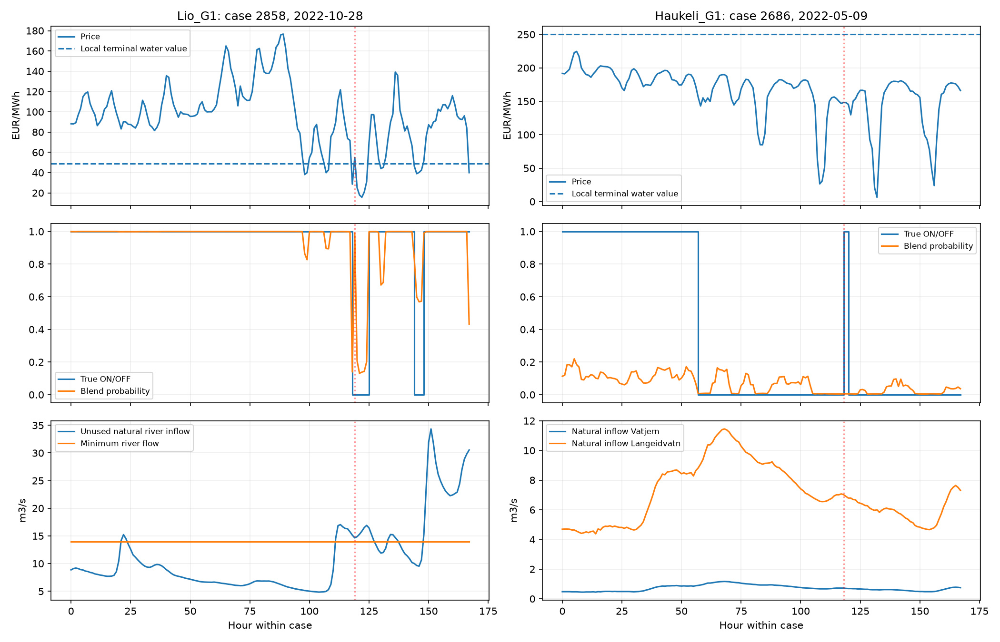

# Project data and model audit

The supplied data and our alignment checks agree on the task format. The clearest confirmed omission is natural inflow to `r_Vest_Vassdraget`: it is supplied in the inflow CSV but never enters the current feature sets. This river receives Lio discharge and has an hourly minimum-flow requirement. Correcting that omission is the most concrete next experiment. Its effect on AUC is not established by this audit, and the audit does not explain the other teams' leaderboard scores.

## Checks that passed

The dataset definitions specify initial storage at the case start and terminal water value at start plus 168 hours. Our code follows that convention. Labels `t0` through `t167` correspond to the first through last hours of each case. The original visualization notebook uses the same generator-major reshape and starts its hourly axis at `starttime`.

Direct checks of the first and last labelled cases confirm price selection, terminal water-value selection, generator/case/hour ordering, and restoration to the submission's columns. The official metric gives AUC 1 for correctly restored truth and computes micro AUC over all outputs, matching our reported scores. There is no evidence here of a one-day shift, transposed labels or the wrong averaging metric.

Every required hourly input and initial/terminal daily input is available for all 3647 cases. Raw timestamps are unique; no required dates or input values are missing. The market-price file contains subhourly rows late in 2025, but our cases end in December 2024, so those rows do not affect current runs.

There are 2922 labelled cases from 2015 through 2022 and 725 separate competition cases from 2023 through 2024. Their case IDs are disjoint. Validation uses chronological case splits and excludes the six starts whose label weeks overlap the validation boundary. Final submission fitting legitimately uses all supplied training labels; the late December 2022 training weeks overlap calendar hours of the first test weeks, but they are separate labelled cases, not competition test labels.

All 15 distributed files match the original ZIP byte for byte, including `kaggle_metric.py`, raw CSVs, YAML and the supplied notebook. The ZIP contains no additional labelled schedule file or training baseline. The visualization notebook refers to a schedule filename absent from the ZIP; its role is plotting rather than a hidden modelling recipe.

## Missing river inflow

Dataset definitions page 1 explicitly lists 17 reservoir inflows and a separate natural inflow series for `r_Vest_Vassdraget`. Our local and system features select reservoir columns; upstream summaries likewise sum reservoirs only. The river input is omitted even when water-context features are enabled.

The YAML connects Lio to `r_Vest_Vassdraget` and that river to Bandak. It also connects bypass and spill routes from other reservoirs to the same river. Natural inflow reduces the amount that must be supplied by those routes to satisfy its flow requirement.

For the current 75% price-XGBoost / 25% original-LightGBM blend, Lio errors at threshold 0.5 are:

| Year | Natural river inflow meets minimum | Natural river inflow below minimum |
|---|---:|---:|
| 2021 | 3.62% of 10 430 outputs | 21.04% of 50 890 outputs |
| 2022 | 2.56% of 11 200 outputs | 21.39% of 50 120 outputs |

These are overlapping case-hour observations and descriptive associations, not independent significance tests or causal estimates. They use a classification threshold for diagnosis; the competition objective remains AUC. A shortfall is not a hard rule forcing Lio ON because other releases can contribute.

The next feature experiment should include hourly natural river inflow, its short-term/remaining sums and minimum-flow requirement minus natural inflow. A further reference can account for supplied minimum releases on connected bypass routes. Such references must be labelled as natural-flow or known-minimum comparisons rather than actual river-flow predictions.

## Fixed small reservoir storage

Dataset definitions page 1 says historical storage is unavailable for Vatjern and Hyljelihyl and their initial storage is set to 50% full. The CSV confirms constant values of 0.15 and 0.13 million m3 respectively.

Haukeli's direct feeding reservoir is Vatjern. Its initial volume and fill fraction cannot explain differences between cases because they are constant. Vatjern also receives water along normal and spill river routes from Langeidvatn. Features that sum all upstream natural inflow do not calculate the timing or feasibility of these actual transfers.

This is a limitation of the supplied initial-state variation and our summaries, not a parsing bug. Later observed storage should not be substituted as an input unavailable at the start of the scheduling case.

## Water values and hydraulic configuration

The dataset definitions specify EUR/MWh and the terminal date. They do not name the SHOP water-value attribute or provide the script that creates each labelled optimization problem. Therefore they establish our date and units but do not prove that arithmetic means or simple price-minus-value features reproduce the optimizer's marginal economics.

SHOP distinguishes local energy values in EUR/MWh from global values per water volume. It converts a local energy value using production efficiency at initial head and adds downstream value when constructing a global reservoir value. [SHOP water-value documentation](https://docs.shop.sintef.energy/examples/water_values/water_values.html)

Our upstream/downstream water-value means and their differences are statistical features. They are not energy-weighted valuations for a cascade. The optional economics features likewise assume a constant reference production level and charge a whole start/stop cycle without knowing the initial unit state. Their mixed backtest results do not validate or invalidate SHOP's actual economics.

The YAML includes volume-to-level curves, turbine and generator efficiency curves, plant losses, minimum/nominal power, bypass/spill routes and flow costs. We do not represent the full hydraulic relationships or solve an hourly water balance. Head, losses and efficiency influence plant production in SHOP. [SHOP plant documentation](https://docs.shop.sintef.energy/objects/plant/plant.html)

## Concrete difficult cases

| Case and hour | Observation | What the current inputs miss or simplify |
|---|---|---|
| Lio, case 2858, hour 119, 2022-11-01 23:00 UTC | True OFF, predicted ON probability 0.99053. Price 54.92 EUR/MWh; feeding water value 49.00. Natural river inflow 14.65 m3/s exceeds required 14.00. | Natural river inflow is absent from the model, and price above supplied water value does not uniquely determine commitment. |
| Lio, case 2872, hour 40, 2022-11-12 16:00 UTC | True ON, predicted probability 0.00953. Price 7.49; water value 67.60. Natural river inflow 9.20 is below required 14.00. | The decision can involve environmental releases and storage management despite a negative simple price margin. The exact contribution of these effects is unobserved. |
| Haukeli, case 2686, hour 118, 2022-05-13 22:00 UTC | True ON, predicted probability 0.00499. Price 148.31; water value 250.51. Vatjern starts at 0.15 million m3. | Local natural inflow through this hour totals 0.326088 million m3, greater than the reservoir's initial free capacity of 0.15. Releases are necessary over the case, but this comparison does not determine the optimal hourly commitment or actual incoming transfers. |

The Haukeli case has 0.433404 million m3 of local natural inflow over its whole week, compared with total reservoir capacity 0.3 million m3. This makes a static price threshold an incomplete description. In case 2872, Byrtevatn starts at 73.639 of 76.71 million m3 and receives 3.40236 million m3 of local natural inflow across the week, before counting upstream transfers. These comparisons describe storage pressure, not calculated trajectories.

The figure shows full weekly prices, labels, probabilities and supplied inflows for selected examples. It cannot identify the solver's exact reasons because actual turbine flows, bypass releases, spill and optimized storage trajectories are not distributed.

## Generator relationships and experiment scope

Vinje commitment is almost always nested by unit number in the 2021 and 2022 labels: there are only 22 and 39 adjacent-unit ordering violations out of 122 640 comparisons per year. Tokke has 5114 and 3400 violations out of 183 960. Identical equipment does not justify imposing the same hard unit-priority rule on both plants. Plant-level counts and unit allocation are possible modelling experiments, not verified improvements.

The CNN and bidirectional LSTM tests each cover one architecture, one main configuration and 2022 validation. They compress many system inputs into a small hidden representation and use standard BCE. Their poor results establish the performance of those runs, not a ceiling for neural sequence models. Repeated use of 2021 and 2022 also means the current results are development scores rather than independent estimates.

## Action after the audit

First test the omitted river inflow and its relationship to minimum flow on the existing chronological splits, preserving the current blend. This fixes a known information omission before adding another approximate physics feature or architecture. If it produces a repeatable gain, check another historical year and then fit a new submission model. No training or model fitting was performed during this audit, and the existing feature code and submissions were preserved.

Reproduce the checks with `python src/audit_project.py`. Numerical checks are in `reports/project_audit.json`; selected mistakes are in `reports/project_audit_cases.csv`. Local source documents are `docs/Dataset_definitions_and_explanation.pdf` pages 1–3, `docs/ML_Task_TDT4173.pdf` pages 1–2, `configs/Tokke_Vinje_topology.yaml`, the original visualization notebook and official metric.
